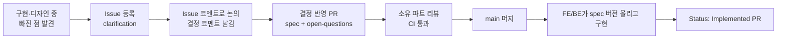

# 명세 레포 사용 가이드

누가 어떻게 **확인하고 · 의견을 내고 · 수정하는지** 정리한 문서입니다.
규칙의 근거는 [헌법](.specify/memory/constitution.md)에 있습니다.

## 전체 흐름



- **결정은 Issue에서, 반영은 PR로** 합니다. 카톡·회의에서 정한 것도 Issue에 "결정: …" 코멘트로 남겨야 유효합니다.
- 요구사항(`spec.md`)은 누구나 PR을 올릴 수 있지만, **머지는 소유 파트 승인**이 있어야 합니다 (CODEOWNERS).

| 파일 | 승인이 필요한 파트 |
|---|---|
| `specs/*/spec.md`, 용어집, 정책, 질문 목록 | 기획 |
| `specs/_shared/screen-map.md` | 기획 + 디자인 |
| `specs/_shared/domain-model.md` | 기획 + BE |
| 헌법 | 기획 + 디자인 + FE + BE |

---

## 기획 · 디자인 (git 없이 GitHub 웹으로)

### 1. 확인하기

- **문서 읽기**: 레포에서 파일을 누르면 서식이 적용된 문서로 보입니다. 시작점은 [README](README.md) → 기능별 `specs/###-*/spec.md`
- **내 할 일 보기**: Issues 탭에서 라벨로 거릅니다.
  - 내 파트가 결정할 질문: `담당:디자인` 또는 `담당:기획` 라벨
  - 급한 것: `유형:모순` 라벨 (서로 다르게 적힌 내용)
  - 특정 기능만: `spec:004-card` 같은 라벨
- **알림 받기**: 레포 우측 상단 **Watch → Custom → Issues, Pull requests** 체크. 내 파트 승인이 필요한 PR은 자동으로 리뷰 요청이 옵니다.
- **최근 바뀐 내용**: 파일 상단 **History** 버튼. 각 변경의 이유는 연결된 PR에 있습니다.

### 2. 질문에 의견 내고 결정하기

1. Issue에 코멘트로 의견을 남깁니다. 시안이 있으면 Figma 링크나 이미지를 붙입니다.
2. 결정되면 담당 파트가 아래 형식으로 코멘트합니다.

   ```
   결정: B. 시작 전
   이유: 카드 상세의 진행도 바 문구와 맞춤
   영향: 카드리스트 필터 문구도 변경 (디자인)
   ```

3. 그다음 결정 반영 PR을 올립니다 (아래 3번). Issue는 PR이 머지되면 자동으로 닫힙니다.

### 3. 직접 수정하기

**파일 하나만 고칠 때**
1. 고칠 파일을 열고 오른쪽 위 **연필(✏️) 아이콘**을 누릅니다.
2. 내용을 고칩니다. `[NEEDS CLARIFICATION: Q-004 …]` 부분을 결정된 내용으로 바꾸는 식입니다.
3. **Commit changes** → **Create a new branch for this commit and start a pull request** 선택 → **Propose changes**
4. PR 화면에서 템플릿 체크리스트를 채우고 본문에 `Closes #4`처럼 Issue 번호를 적은 뒤 **Create pull request**

**여러 파일을 같이 고칠 때** (예: spec + `open-questions.md` 결정 열)
1. 레포 화면에서 키보드 **`.`(마침표)** 를 누르면 웹 편집기(github.dev)가 열립니다.
2. 왼쪽 파일 목록에서 여러 파일을 고칩니다.
3. 왼쪽 **Source Control** 아이콘 → 변경 내용 설명 입력 → **Commit & Push** → 새 브랜치를 만들겠냐는 안내에서 **Create new branch**를 고르고 → 이어서 뜨는 안내로 PR을 만듭니다.

**AI 에이전트(Claude Code · Codex)에게 맡길 때**
- Claude Code(claude.ai/code)나 Codex(chatgpt.com/codex)에서 이 레포를 연결하고 "Q-004 결정됐어. B안 '시작 전'으로 반영하고 PR 올려줘"처럼 요청하면, 관련 spec·용어집·질문 목록을 함께 고쳐 PR을 올립니다. 두 에이전트 모두 [`AGENTS.md`](AGENTS.md)의 같은 규칙을 따릅니다.
- 남은 질문을 하나씩 물어보며 결정하고 싶으면 "004-card spec으로 clarify 진행해줘"라고 하세요. 명령으로 직접 부를 때는 Claude Code `/speckit-clarify`, Codex `$speckit-clarify` 입니다.
- 에이전트가 올린 PR도 사람이 리뷰하고 승인해야 머지됩니다.

### 4. PR 리뷰하기

1. PR의 **Files changed** 탭에서 바뀐 줄을 봅니다 (빨강 = 삭제, 초록 = 추가).
2. 줄 옆 **+** 를 눌러 코멘트하거나, **Suggestion** 버튼으로 고칠 문구를 직접 제안할 수 있습니다.
3. 다 봤으면 **Review changes → Approve** (문제가 있으면 **Request changes**)

### 5. 자동 검사(CI)가 실패했을 때

PR 아래에 빨간 ✕ 가 보이면 **Details**를 누르세요. 한국어로 원인이 나옵니다.

| 메시지 | 고치는 방법 |
|---|---|
| `Q-123 가 open-questions.md 에 없습니다` | 새 질문이면 `open-questions.md` 표에 Q-123 줄을 추가 |
| `Status 가 Approved 인데 NEEDS CLARIFICATION 이 …개` | 남은 질문을 먼저 결정하거나 Status를 `Draft`로 되돌림 |
| `FR-CARD-045 가 … 에도 정의되어 있습니다` | 번호가 겹침. 새 요구사항은 그 spec의 마지막 번호 다음을 사용 |
| `화면 ID … 가 screen-map.md 에 없습니다` | `screen-map.md`에 화면을 먼저 추가 |

### 디자인 추가 규칙

- Figma 프레임 이름은 `[화면 ID] 화면명` (예: `[EDIT-DATETIME] 날짜/시간 바텀시트`)
- 새 화면을 그리면 `screen-map.md`에 화면 ID를 추가하고 Figma 열에 프레임 링크를 넣습니다.
- 문구 · 토스트 · 빈 상태 · 오류 문구는 각 spec의 `UI Notes` 섹션에 적습니다. **Figma에만 있는 문구는 확정이 아닙니다.**

---

## FE · BE (git)

### 1. 처음 한 번: 내 레포에 연결

```bash
git submodule add https://github.com/unplan-tave/spec.git spec
```

```bash
git commit -m "chore: 명세 레포 연결"
```

다른 팀원이 처음 받을 때는 아래를 실행합니다.

```bash
git submodule update --init
```

submodule은 **특정 커밋에 고정**됩니다. 그래서 FE/BE 레포의 각 커밋이 "어느 시점의 명세로 구현했는지"를 기록하게 됩니다.

### 2. 명세 업데이트 받기

```bash
git submodule update --remote spec
```

```bash
git add spec && git commit -m "chore: spec 업데이트 (Q-004, Q-022 반영)"
```

받기 전에 무엇이 바뀌는지 확인합니다 (예: 카드 spec만).

```bash
git -C spec fetch origin main && git -C spec log --oneline HEAD..origin/main -- specs/004-card specs/_shared
```

```bash
git -C spec diff HEAD..origin/main -- specs/004-card
```

- 명세 버전 올리기는 **별도 PR**로 합니다 (`chore: spec 업데이트 (Q-004, Q-022 반영)`). 리뷰어가 어떤 요구사항 변경에 맞춰 코드를 바꾸는지 보기 쉽습니다.
- 마일스톤마다 이 레포에 태그(`v0.1` 등)를 붙이면 FE와 BE가 같은 버전에 맞추기 쉽습니다.

### 3. 무엇을 구현해도 되는지 확인

- spec 상단 `Status`가 **`Approved`** 인 것만 착수합니다.
- `Draft` spec도 질문이 걸리지 않은 요구사항은 먼저 작업할 수 있지만, 바뀔 수 있다는 걸 감안합니다.
- 검증 규칙(글자 수, 개수 제한, 시간 단위)과 enum 코드값은 `glossary.md`, `policies.md`, `domain-model.md`의 값을 그대로 씁니다. FE와 BE가 같은 값을 쓰는지 리뷰 때 확인합니다.

### 4. 구현 중 명세와 다른 점을 발견하면

- **코드에서 임의로 정하지 않습니다.** 이 레포에 Issue를 올립니다: **New issue → 결정 필요 (Clarification)**
  - 작업이 막혀 있으면 "구현을 막고 있나"에 **예**를 고릅니다.
- 기술적으로 불가능하거나 비용이 큰 요구사항도 같은 방식으로 Issue를 올립니다 (예: "제목 기반 컨디션 태그 자동 분류는 외부 AI 비용이 듭니다").
- 직접 고칠 수 있는 범위:
  - BE: `domain-model.md` (기획과 공동 승인)
  - FE·BE: `scripts/`, CI
  - 요구사항(`spec.md`) 변경 PR도 올릴 수 있지만, 머지는 기획 승인 후입니다.

### 5. 코드에 ID 남기기

| 어디에 | 예시 |
|---|---|
| 커밋 / PR 제목 | `feat(card): 일정 시간 중복 검사 (FR-CARD-045)` |
| 테스트 이름 | `FR-CARD-045: 끝 시각과 다음 시작 시각이 같아도 겹침으로 본다` |
| 화면 컴포넌트 | `EditDateTimeSheet` 파일 상단 주석 `// EDIT-DATETIME` |
| API 계약 (`openapi.yaml`) | 엔드포인트 설명에 관련 FR-ID |

구현 계획(`plan.md`), 작업 목록(`tasks.md`), API 계약은 **각자 레포**에 둡니다. spec-kit을 쓴다면 FE/BE 레포에서 plan·tasks 명령(Claude Code `/speckit-plan`, Codex `$speckit-plan` 등)을 실행할 때 `spec/specs/###-*/spec.md`를 입력으로 줍니다.

### 6. 구현이 끝나면

이 레포에 PR을 올려 해당 spec의 `Status`를 `Implemented`로 바꾸고, `Changelog`에 FE/BE PR 링크를 남깁니다.

### 로컬 검사

```bash
node scripts/check-specs.ts
```

Node 22.18 이상이 필요합니다. PR마다 CI에서도 같은 검사를 합니다.

---

## 자주 묻는 것

**Q. 회의에서 바로 정했는데 꼭 PR까지 해야 하나요?**
네. PR로 머지되기 전까지는 FE/BE가 그 결정을 볼 방법이 없습니다. Issue에 결정 코멘트를 남기고 담당자를 정해 두면 됩니다.

**Q. 오탈자 하나 고치는 것도 PR인가요?**
네. 다만 동작이 바뀌지 않는 수정은 PR 템플릿에서 "문구 · 오탈자"만 체크하면 되고, 리뷰도 가볍게 합니다.

**Q. Approved된 spec을 바꿔야 하면?**
PR에서 Status를 `Clarified`로 내리고 `Changelog`에 이유를 적습니다. 머지되면 FE/BE는 명세 업데이트를 받을 때 diff로 변경을 확인합니다.
