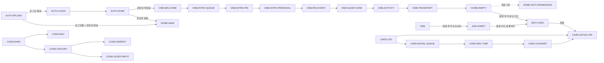

# 화면 맵 (Screen Map)

> 원본 시트의 `화면 ID` 열이 비어 있어 이번 이관 때 새로 부여했다. Figma 프레임 이름은 `[화면 ID] 화면명` 으로 맞춘다.
> `유형`: Full = 전체 화면, BS = 바텀시트, Modal, Toast
> `GNB`: 표시 / 숨김 / ⚠️(미정, Q-002)

| 화면 ID | 화면명 | 유형 | GNB | spec | Figma |
|---|---|---|---|---|---|
| **인증** | | | | | |
| `AUTH-SPLASH` | 스플래시 | Full | 숨김 | 001 | |
| `AUTH-LOGIN` | 소셜 로그인 | Full | 숨김 | 001 | |
| `AUTH-TERMS` | 약관 선택 | BS | 숨김 | 001 | |
| `AUTH-TERMS-SERVICE` | 서비스 이용약관 | BS | 숨김 | 001 | |
| `AUTH-TERMS-PRIVACY` | 개인정보 수집 및 이용약관 | BS | 숨김 | 001 | |
| `AUTH-DONE` | 로그인 완료 | Full | 숨김 | 001 | |
| **온보딩** | | | | | |
| `ONB-WELCOME` | 환영 | Full | 숨김 | 002 | |
| `ONB-INTRO-QUEUE` | 큐 카드 소개 | Full | 숨김 | 002 | |
| `ONB-INTRO-PIN` | 핀 카드 소개 | Full | 숨김 | 002 | |
| `ONB-INTRO-PERSONAL` | 개인화 추천 안내 | Full | 숨김 | 002 | |
| `ONB-RECOVERY` | 컨디션 회복 방법 | Full | 숨김 | 002 | |
| `ONB-SLEEP-ZONE` | 수면 시간별 컨디션 | Full | 숨김 | 002 | |
| `ONB-ACTIVITY` | 하루 활동 패턴 | Full | 숨김 | 002 | |
| `ONB-TRANSPORT` | 선호 이동방식 | Full | 숨김 | 002 | |
| **홈** | | | | | |
| `HOME-MAIN` | 홈 (Daily/Weekly/Monthly) | Full | 표시 | 003 | |
| `HOME-EMPTY` | 초기 홈화면 | Full | 표시 | 003 | |
| `HOME-NOTI-PERMISSION` | 알림 허용 안내 | Modal | ⚠️ | 003 | |
| `HOME-DATE-PICKER` | 날짜 선택 달력 | BS | ⚠️ | 003 | |
| `HOME-MEMO` | 날짜별 메모 | BS | ⚠️ | 003 | |
| `NOTI-LIST` | 알림 페이지 | Full | 숨김 | 008 | |
| **카드리스트** | | | | | |
| `CARD-LIST` | 카드리스트 메인 | Full | 표시 | 005 | |
| `CARD-SEARCH` | 카드 검색 | Full | ⚠️ | 005 | |
| `CARD-DETAIL-PIN` | 핀 카드 상세 | Full | ⚠️ | 004 | |
| `CARD-DETAIL-QUEUE` | 큐 카드 상세 | Full | ⚠️ | 004 | |
| `CARD-REC-TIME` | 추천 시간 확인 | BS | ⚠️ | 004 | |
| `CARD-CONVERT` | 핀카드 전환 확인 | BS | ⚠️ | 004 | |
| `CARD-CONVERT-MANUAL` | 마감일·소요시간 입력 (전환용) | BS | ⚠️ | 004 | |
| **카드 추가·편집** | | | | | |
| `ADD-SHEET` | 일정 추가 바텀시트 | BS | ⚠️ | 004 | |
| `EDIT-CARD` | 카드 편집 | Full | 숨김 (제안) | 004 | |
| `EDIT-TAG` | 태그 바텀시트 | BS | 숨김 | 004 | |
| `EDIT-DATETIME` | 날짜/시간 바텀시트 | BS | 숨김 | 004 | |
| `EDIT-TIME-UNSET` | 시간 미설정 일정 확인 | Modal | 숨김 | 004 | |
| `EDIT-LOCATION` | 위치 바텀시트 | BS | 숨김 | 004 | |
| `EDIT-DEADLINE` | 마감일/소요시간 바텀시트 | BS | 숨김 | 004 | |
| **컨디션** | | | | | |
| `COND-MAIN` | 컨디션 메인 | Full | 표시 | 006 | |
| `COND-REC` | 컨디션 기반 추천 일정 | BS | ⚠️ | 007 | |
| `COND-HISTORY` | 컨디션 기록 내역 (Body/Mind, Sleep 탭) | Full | ⚠️ | 006 | |
| `COND-ENERGY` | 에너지 측정 | Full | ⚠️ | 006 | |
| `COND-SLEEP-INPUT` | 수면 측정 | Full | ⚠️ | 006 | |
| **설정** | | | | | |
| `SET-MAIN` | 설정 메인 | Full | 표시 | 009 | |
| `SET-ACCOUNT` | 계정 정보 수정 | Full | ⚠️ | 009 | |
| `SET-PERSONAL-*` | 추천 개인화 하위 화면들 | Full | ⚠️ | 009 | |

## 화면 이동 그래프 (요약)

